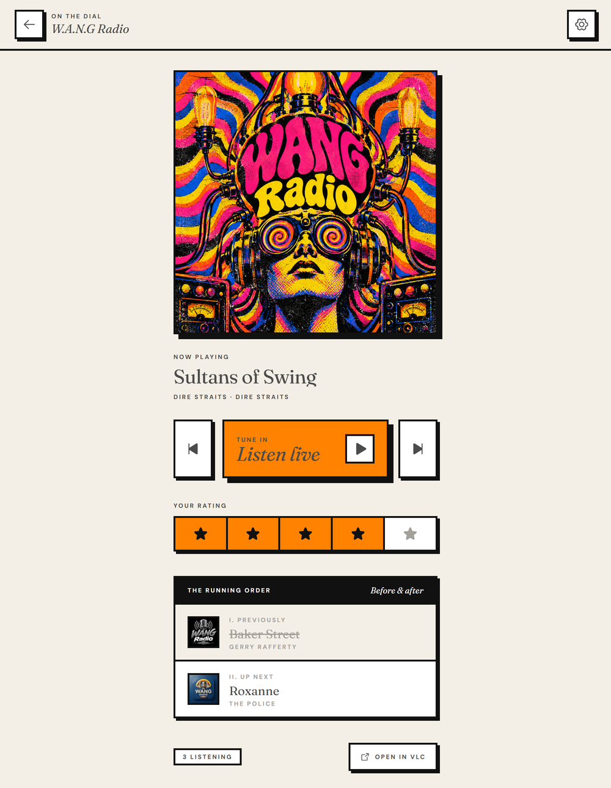
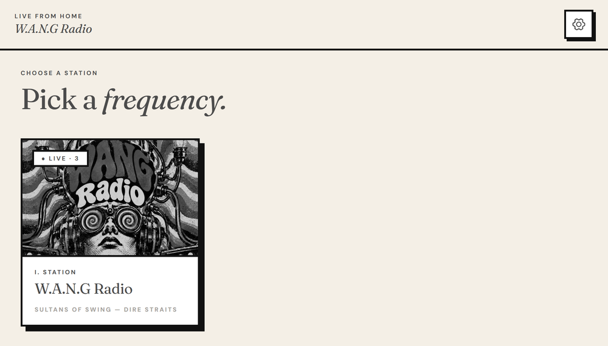
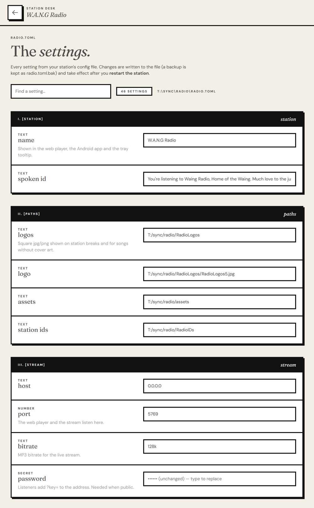

# WANG Radio — Android companion app

Plays your HomeRadio station on your phone and in Android Auto. It shows album artwork, and star ratings are saved on the station PC and copied to Plex.

## Screenshots

  
  

<i>The web player and the station picker (sample song data).</i>

<i>The settings page edits every value in <code>radio.toml</code> in place, and keeps a backup.</i>

## Get the APK (no Android Studio needed)
1. Create a free GitHub account, then make a new **private** repository named `wang-radio`.
2. Upload everything in this folder to that repository. On the repository page, choose **Add file → Upload files** and drag the folder contents in. Include the hidden `.github` folder, because that is what builds the app.
3. Open the **Actions** tab. The **Build WANG Radio APK** job runs automatically and takes about 5 minutes.
4. Open the finished run and download **WANG-Radio-apk** under *Artifacts*. Unzip it to get `WANG-Radio.apk`.
5. Copy the APK to your phone and tap it to install. Android asks you to allow installs from that source; allow it.

You can also build it in Android Studio: **Open** this folder, then choose **Build → Build APK(s)**.

## Connect the app to your station
- **Easiest:** when the station starts, tap **Open in WANG Radio** on the ntfy notification on your phone. The app fills in the station address and password for you, and it stays up to date when the Cloudflare link changes.
- **By hand:** tap ⚙ in the app and enter the station address and the `password` from `radio.toml`.

## Android Auto
Android Auto only shows apps installed from the Play Store unless you turn on unknown sources. Do this once on your phone:
1. Open **Settings → Apps → Android Auto → Additional settings in the app**.
2. Tap **Version** about 10 times until developer mode turns on.
3. Open **⋮ → Developer settings** and turn on **Unknown sources**.
4. Restart Android Auto. WANG Radio then appears in the car's app list.

In the car you get artwork, song title and artist, play/stop, five ★ buttons, ⏮ back and ⏭ next. The stars come first, so Android Auto puts them in the main spots next to play/stop. Back and next come after the stars, and on smaller car screens they may sit behind the ⋯ (more) button. Steering-wheel next and back buttons still work.

**Rating in the car:** tap a star to rate the song; it's saved right away. ★ (1 star) plays the record scratch and skips the song.

## Controls
- **⏭ Next:** the station plays `next.mp3`, then the next song.
- **⏮ Back:** the station plays `back.mp3`, then the previous song. Press it again to keep going further back.
- **1 star:** saves the rating, plays `record_scratch.mp3`, then skips to the next song.
- **Previously / Up next:** shown under the controls, with artwork.

The three sound effects go in a folder called `assets` next to `radio.py`. These controls change the station itself, so anyone else listening hears the skip too. You'll hear the change about 2–5 seconds after you press the button, because of stream buffering.

## Star ratings and Plex
Tap 1–5 stars in the app or the web player (or the ★ buttons in Android Auto). Tapping the same star again clears the rating. The station saves the stars in `ratings.json` (every rating is also logged in `ratings_log.csv`) and copies them to Plex. Songs rated 1–2 stars come up less often and 4–5 stars a bit more; turn that off with `[ratings] influence_rotation = false`. This is one way only: ratings you change in Plex aren't read back.

To connect Plex, fill in the `[plex]` section of `radio.toml` with your Plex address and token. The station log shows "Plex connected" at startup and "Plex: rated …" each time a rating goes through. The station finds each song in Plex by its file path. If Plex sees your music under a different path, for example through a network share, it matches by file name instead.

## Artwork
For each song, the station uses the cover art embedded in the music file. If there isn't any, it uses `cover.jpg`, `folder.jpg` or `front.jpg` from the song's folder. During station breaks, or when a song has no art, the app shows the WANG Radio logo. You can also set your own fallback image with `logo = "C:/path/logo.png"` in `radio.toml`.